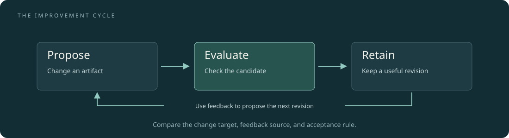

# Awesome Recursive Self-Improvement

Self-improving agents, evolving evaluators, skills, and harnesses.

  

[Browse online](https://asimfish.github.io/awesome_rsi/) · [Start reading](#start-reading) · [Browse by topic](#topics) · [Core readings](#core-readings) · [Contribute](CONTRIBUTING.md)

## Start reading

Explore how AI systems revise their code, feedback, weights, and memory. A curated collection of research, evaluation methods, and open-source systems.

| Your goal | Start here |
| --- | --- |
| Understand the field | [English reading guide](guide.md) |
| Follow a short route | [Core readings](#core-readings) |
| Find a specific method | [Topic index](#topics) or the searchable [paper browser](https://asimfish.github.io/awesome_rsi/#library) |
| Reuse the collection | [Machine-readable catalog](data/papers.json) |

Open <code>index.html</code> in a browser for search, topic and year filters, sorting, saved readings, and links to papers and code. It works offline; external resources still need a connection. Filter links can be shared when the page is served over HTTP.

## Topics

Choose a subject first; use the core reading route for an introduction.

| Topic | Entries | Scope |
| --- | ---: | --- |
| [Foundations & surveys](#foundations-surveys) | 14 | Origins, definitions, and research overviews. |
| [Agent code & harnesses](#agent-code-harnesses) | 19 | Changes to agent implementations and orchestration. |
| [Evaluators & feedback](#evaluators-feedback) | 7 | How feedback is learned, checked, and revised. |
| [Model training](#model-training) | 8 | Weight updates and joint optimization. |
| [Memory & skills](#memory-skills) | 12 | Persistent knowledge, context, and reusable skills. |
| [Online adaptation](#online-adaptation) | 5 | Updates during continuing interaction and environment changes. |
| [Program & workflow search](#program-workflow-search) | 6 | Search over programs, prompts, and agent workflows. |
| [Autonomous research](#autonomous-research) | 9 | Systems that conduct experiments and develop models. |
| [Safety & measurement](#safety-measurement) | 24 | Verification, release criteria, failure modes, and measurement. |
| [Tools & infrastructure](#tools-infrastructure) | 3 | Runnable systems and supporting infrastructure. |

Each reference has one primary topic. Resource labels distinguish papers, surveys, articles, books, and tools.

## Core readings

1. **Harness Engineering for Self-Improvement.** [Article](https://lilianweng.github.io/posts/2026-07-04-harness/)

   An overview of optimizing prompts, context, workflows, agent code, and the improvement mechanism itself.

2. **When AI Builds Itself: Anthropic's Progress toward Recursive Self-Improvement.** [Article](https://www.anthropic.com/institute/recursive-self-improvement)

   An industry account of AI-assisted engineering and research, with a distinction between executing experiments and choosing them.

3. **Darwin Gödel Machine: Open-Ended Evolution of Self-Improving Agents.** [Paper](https://arxiv.org/abs/2505.22954) · [Code](https://github.com/jennyzzt/dgm) · [PDF](papers/en/2505.22954_DGM.pdf)

   Searches an archive of self-modifying coding agents using empirical evaluation.

4. **MOSS: Self-Evolution through Source-Level Rewriting in Autonomous Agent Systems.** [Paper](https://arxiv.org/abs/2605.22794) · [Code](https://github.com/hkgai-official/Moss) · [PDF](papers/en/2605.22794_MOSS.pdf)

   Uses production failure records to propose source-code changes, with isolated replay, approval, and rollback.

5. **EvoLM: Self-Evolving Language Models through Co-Evolved Discriminative Rubrics.** [Paper](https://arxiv.org/abs/2605.03871) · [Code](https://github.com/stellalisy/EvoLM) · [PDF](papers/en/2605.03871_EvoLM.pdf)

   Alternates policy learning with the evolution of discriminative evaluation rubrics.

6. **The Red Queen Gödel Machine: Co-Evolving Agents and Their Evaluators.** [Paper](https://arxiv.org/abs/2606.26294) · [PDF](papers/en/2606.26294_RQGM.pdf)

   Co-evolves agents and evaluators, checking candidate evaluators against human-labeled reference data.

7. **Who Grades the Grader? Co-Evolving Evaluation Metrics and Skills for Self-Improving LLM Agents.** [Paper](https://arxiv.org/abs/2607.12790) · [Code](https://github.com/amazon-science/Self-Evolving-Agents-Double-Ratchet) · [PDF](papers/en/2607.12790_WhoGradesTheGrader.pdf)

   Studies how evolving evaluation metrics can drift even when downstream task scores remain high.

8. **No More Stale Feedback: Co-Evolving Critics for Open-World Agent Learning (ECHO).** [Paper](https://arxiv.org/abs/2601.06794) · [PDF](papers/en/2601.06794_ECHO.pdf)

   Updates a critic alongside a policy, rewarding feedback that improves subsequent task performance.

9. **WikiSkill: Compiling Agent Experience into Persistent Knowledge for Skill Evolution.** [Paper](https://arxiv.org/abs/2608.27454) · [PDF](papers/en/2608.27454_WikiSkill.pdf)

   Separates raw experience, persistent wiki knowledge, and validated, reversible skills.

10. **Continual Harness: Online Adaptation for Self-Improving Foundation Agents.** [Paper](https://arxiv.org/abs/2605.09998) · [Project](https://sethkarten.ai/continual-harness) · [PDF](papers/en/2605.09998_ContinualHarness.pdf)

   Refines an agent's harness within a continuing episode without resetting the environment.

## Catalog

Expand a topic to see its references. Listed years follow the source catalog and may reflect a publication venue rather than the first preprint date.

### Foundations & surveys

Origins, definitions, and research overviews.

View 14 entries

- **A Survey of Self-Evolving Agents: What, When, How, and Where to Evolve on the Path to Artificial Super Intelligence.** TMLR, 2026. [Paper](https://arxiv.org/abs/2507.21046) · [Code](https://github.com/CharlesQ9/Self-Evolving-Agents) · [PDF](papers/en/2507.21046_SelfEvolvingAgentsSurvey.pdf)

  Organizes self-evolving agents by what, when, how, and where they change.

- **Co-Evolution in Agentic Systems: Toward Self-Directed Evolution Beyond Human Design.** arXiv, 2026. [Paper](https://arxiv.org/abs/2608.10299) · [PDF](papers/en/2608.10299_CoEvolutionSurvey.pdf)

  Surveys interactions among evolving agents, environments, and improvement mechanisms.

- **Harness Engineering for Self-Improvement.** Lil'Log, 2026. [Article](https://lilianweng.github.io/posts/2026-07-04-harness/)

  An overview of optimizing prompts, context, workflows, agent code, and the improvement mechanism itself.

- **Safety in Self-Evolving Agents: A Survey.** arXiv, 2026. [Paper](https://arxiv.org/abs/2610.00093)

  Surveys how reusable agent state can become unsafe as models, memory, tools, skills, and workflows evolve.

- **Self-Evolving Coding Agents.** arXiv, 2026. [Paper](https://arxiv.org/abs/2608.03392) · [Collection](https://github.com/iSEngLab/Awesome-Self-Evolving-Coding-Agents) · [PDF](papers/en/2608.03392_SelfEvolvingCodingAgentsSurvey.pdf)

  Surveys evolution targets, timing, and evidence in coding agents, including risks from unreliable tests.

- **When AI Builds Itself: Anthropic's Progress toward Recursive Self-Improvement.** Anthropic Institute, 2026. [Article](https://www.anthropic.com/institute/recursive-self-improvement)

  An industry account of AI-assisted engineering and research, with a distinction between executing experiments and choosing them.

- **Superintelligence: Paths, Dangers, Strategies.** Oxford University Press, 2014. [Book](https://global.oup.com/academic/product/superintelligence-9780199678112)

  Develops a framework for optimization power, resistance to improvement, and recursive capability growth.

- **Intelligence Explosion Microeconomics.** MIRI Technical Report, 2013. [Paper](https://intelligence.org/files/IEM.pdf) · [PDF](papers/classics/2013_Yudkowsky_IEM.pdf)

  Studies returns to reinvesting cognitive capability and resistance to further improvement.

- **The Singularity: A Philosophical Analysis.** Journal of Consciousness Studies, 2010. [Paper](http://consc.net/papers/singularity.pdf) · [PDF](papers/classics/2010_Chalmers_Singularity.pdf)

  Separates the premises of intelligence-explosion arguments and examines potential limiting factors.

- **The Basic AI Drives.** AGI-08, 2008. [Paper](https://selfawaresystems.com/wp-content/uploads/2008/01/ai_drives_final.pdf) · [PDF](papers/classics/2008_Omohundro_BasicAIDrives.pdf)

  Analyzes instrumental incentives such as resource acquisition, self-preservation, and goal preservation.

- **Gödel Machines: Self-Referential Universal Problem Solvers Making Provably Optimal Self-Improvements.** arXiv, 2003. [Paper](https://arxiv.org/abs/cs/0309048) · [PDF](papers/classics/2003_Schmidhuber_GoedelMachines.pdf)

  A formal system that permits self-modification after proving an increase in expected utility.

- **General Intelligence and Seed AI 2.3.** Singularity Institute, 2001. [Archive](https://web.archive.org/web/20120805130100/singularity.org/files/GISAI.html) · [PDF](papers/classics/2001_Yudkowsky_GISAI.pdf)

  Examines the abilities and continuing opportunities needed for a seed AI to improve itself.

- **The Coming Technological Singularity: How to Survive in the Post-Human Era.** VISION-21 Symposium, 1993. [Essay](https://edoras.sdsu.edu/~vinge/misc/singularity.html)

  Explores several possible routes to intelligence beyond human capabilities.

- **Speculations Concerning the First Ultraintelligent Machine.** Advances in Computers Vol. 6, 1965. [Paper](http://incompleteideas.net/papers/Good65ultraintelligent.pdf) · [PDF](papers/classics/1965_Good_UltraintelligentMachine.pdf)

  The original positive-feedback argument: a sufficiently capable machine could help design a more capable successor.

[Back to topics](#topics)

### Agent code & harnesses

Changes to agent implementations and orchestration.

View 19 entries

- **Agentic Harness Engineering: Observability-Driven Automatic Evolution of Coding-Agent Harnesses (AHE).** arXiv, 2026. [Paper](https://arxiv.org/abs/2604.25850) · [Code](https://github.com/china-qijizhifeng/agentic-harness-engineering) · [PDF](papers/en/2604.25850_AHE.pdf)

  Requires execution evidence and falsifiable predictions for harness changes.

- **AutoSaddler: Automatic Harness Optimization with Durable Updates from Agent Execution Traces.** arXiv, 2026. [Paper](https://arxiv.org/abs/2608.23041) · [Project](https://aka.ms/AutoSaddler-website) · [PDF](papers/en/2608.23041_AutoSaddler.pdf)

  Optimizes harnesses from batches of execution traces and validates durable updates.

- **Darwin Gödel Machine: Open-Ended Evolution of Self-Improving Agents.** ICLR, 2026. [Paper](https://arxiv.org/abs/2505.22954) · [Code](https://github.com/jennyzzt/dgm) · [PDF](papers/en/2505.22954_DGM.pdf)

  Searches an archive of self-modifying coding agents using empirical evaluation.

- **DemoEvolve: Overcoming Sparse Feedback in Agentic Harness Evolution with Demonstrations.** arXiv, 2026. [Paper](https://arxiv.org/abs/2605.24539) · [PDF](papers/en/2605.24539_DemoEvolve.pdf)

  Adds human demonstrations to harness evolution when outcome feedback is sparse.

- **Evolving Agents in the Dark: Retrospective Harness Optimization via Self-Preference (RHO).** arXiv, 2026. [Paper](https://arxiv.org/abs/2606.05922) · [Code](https://github.com/wbopan/retro-harness) · [PDF](papers/en/2606.05922_RHO.pdf)

  Uses past trajectories and self-preference to select harness revisions without labeled feedback.

- **From Failed Trajectories to Reliable LLM Agents: Diagnosing and Repairing Harness Flaws (HarnessFix).** arXiv, 2026. [Paper](https://arxiv.org/abs/2606.06324) · [PDF](papers/en/2606.06324_HarnessFix.pdf)

  Diagnoses responsibility for failures and repairs the corresponding harness components.

- **Harness Updating Is Not Harness Benefit: Disentangling Evolution Capabilities in Self-Evolving LLM Agents.** arXiv, 2026. [Paper](https://arxiv.org/abs/2605.30621) · [PDF](papers/en/2605.30621_HarnessUpdatingNotBenefit.pdf)

  Separately measures the ability to produce helpful edits and the ability to benefit from them.

- **Hierarchical Self-Improvement: A Framework for Task-Specific Evolvable Agent Harnesses (HSI).** arXiv, 2026. [Paper](https://arxiv.org/abs/2608.08466) · [PDF](papers/en/2608.08466_HSI.pdf)

  Maintains task-specific, replaceable harnesses under a fixed meta-evolver.

- **HyperAgents.** arXiv, 2026. [Paper](https://arxiv.org/abs/2603.19461) · [PDF](papers/en/2603.19461_Hyperagents.pdf)

  Adds a meta-agent that controls how a task agent is modified.

- **Mendel Gödel Machine: Recursive Self-Improving Coding Agents via Comparative Evolution.** arXiv, 2026. [Paper](https://arxiv.org/abs/2608.07645) · [Code](https://github.com/RealLcz/MGM)

  Uses comparisons across tasks and agent lineages to guide mutations in self-improving coding agents.

- **Meta-Harness: End-to-End Optimization of Model Harnesses.** arXiv, 2026. [Paper](https://arxiv.org/abs/2603.28052) · [Code](https://github.com/stanford-iris-lab/meta-harness-tbench2-artifact) · [PDF](papers/en/2603.28052_MetaHarness.pdf)

  Uses execution history, source code, and feedback to optimize an entire agent harness.

- **Metaⁿ: Recursive Self-Improvement through Emergent Depth.** arXiv, 2026. [Paper](https://arxiv.org/abs/2608.24735) · [Code](https://github.com/minnesotanlp/meta-n) · [PDF](papers/en/2608.24735_Metan.pdf)

  Applies a fixed meta-operation repeatedly to traces and code, creating successive improvement layers.

- **MOSS: Self-Evolution through Source-Level Rewriting in Autonomous Agent Systems.** arXiv, 2026. [Paper](https://arxiv.org/abs/2605.22794) · [Code](https://github.com/hkgai-official/Moss) · [PDF](papers/en/2605.22794_MOSS.pdf)

  Uses production failure records to propose source-code changes, with isolated replay, approval, and rollback.

- **Predict Before You Modify: Learning Improvement Dynamics for Self-Evolving Agents.** arXiv, 2026. [Paper](https://arxiv.org/abs/2610.13991)

  Learns a persistent model of improvement dynamics to predict the effects of candidate agent modifications.

- **RRSI: Regularized Recursive Self-Improvement of Agent Harnesses.** arXiv, 2026. [Paper](https://arxiv.org/abs/2609.24972) · [Code](https://github.com/google-research/rrsi)

  Regularizes harness evolution by controlling edit size, screening proposals, and pruning unhelpful changes.

- **Self-Harness: Harnesses That Improve Themselves.** arXiv, 2026. [Paper](https://arxiv.org/abs/2606.09498) · [PDF](papers/en/2606.09498_SelfHarness.pdf)

  Accepts bounded harness edits only after checks on both development and held-out splits.

- **VERSE: Verified Self-Evolving Optimizer for Agent Harnesses.** arXiv, 2026. [Paper](https://arxiv.org/abs/2610.02616) · [Code](https://github.com/wzekai/VERSE)

  Evolves an agent harness and its optimizer while checking candidate changes through execution.

- **A Self-Improving Coding Agent (SICA).** arXiv, 2025. [Paper](https://arxiv.org/abs/2504.15228) · [Code](https://github.com/MaximeRobeyns/self_improving_coding_agent) · [PDF](papers/en/2504.15228_SICA.pdf)

  Lets a coding agent revise its own code, with explicit utility, a version archive, and asynchronous supervision.

- **Gödel Agent: A Self-Referential Agent Framework for Recursively Self-Improvement.** arXiv, 2024. [Paper](https://arxiv.org/abs/2410.04444) · [Code](https://github.com/Arvid-pku/Godel_Agent) · [PDF](papers/en/2410.04444_GodelAgent.pdf)

  Uses an LLM to inspect and modify an agent's own implementation during execution.

[Back to topics](#topics)

### Evaluators & feedback

How feedback is learned, checked, and revised.

View 7 entries

- **EvoLM: Self-Evolving Language Models through Co-Evolved Discriminative Rubrics.** arXiv, 2026. [Paper](https://arxiv.org/abs/2605.03871) · [Code](https://github.com/stellalisy/EvoLM) · [PDF](papers/en/2605.03871_EvoLM.pdf)

  Alternates policy learning with the evolution of discriminative evaluation rubrics.

- **Metrics That Write Themselves: Evolving an Evaluator from Its Own Blind Spots (EvalCEGAR).** arXiv, 2026. [Paper](https://arxiv.org/abs/2608.18744) · [PDF](papers/en/2608.18744_EvalCEGAR.pdf)

  Refines evaluation operators using answer pairs that receive the same score despite different reference outcomes.

- **Self-Evolving Deep Research via Joint Generation and Evaluation (SCORE).** arXiv, 2026. [Paper](https://arxiv.org/abs/2606.04507) · [PDF](papers/en/2606.04507_SCORE.pdf)

  Jointly trains generation and evaluation for open-ended research reports.

- **The Red Queen Gödel Machine: Co-Evolving Agents and Their Evaluators.** arXiv, 2026. [Paper](https://arxiv.org/abs/2606.26294) · [PDF](papers/en/2606.26294_RQGM.pdf)

  Co-evolves agents and evaluators, checking candidate evaluators against human-labeled reference data.

- **VeriEvolve: Evaluator-First Evolution for Tool-Using Agents.** EMNLP Workshop (REALM), 2026. [Paper](https://arxiv.org/abs/2610.29005)

  Builds executable evaluators before evolving tool-use workflows, then revises the evaluators between rounds.

- **Who Grades the Grader? Co-Evolving Evaluation Metrics and Skills for Self-Improving LLM Agents.** arXiv, 2026. [Paper](https://arxiv.org/abs/2607.12790) · [Code](https://github.com/amazon-science/Self-Evolving-Agents-Double-Ratchet) · [PDF](papers/en/2607.12790_WhoGradesTheGrader.pdf)

  Studies how evolving evaluation metrics can drift even when downstream task scores remain high.

- **Who Verifies the Verifier? Co-Evolving Inspectable Graders with Self-Improving Agents.** NeurIPS Workshop, 2026. [Paper](https://arxiv.org/abs/2610.11464)

  Co-evolves inspectable graders with agents and tests the role of independent reference examples.

[Back to topics](#topics)

### Model training

Weight updates and joint optimization.

View 8 entries

- **Co-Harness: Co-Evolving Harnesses and Model Weights for LLM Agents.** arXiv, 2026. [Paper](https://arxiv.org/abs/2607.22688) · [PDF](papers/en/2607.22688_CoHarness.pdf)

  Alternates diagnosis of harness failures with model training on improved execution traces.

- **Evolving-RL: End-to-End Optimization of Experience-Driven Self-Evolving Capability within Agents.** arXiv, 2026. [Paper](https://arxiv.org/abs/2605.10663) · [Code](https://github.com/Fanzy27/Evolving-RL) · [PDF](papers/en/2605.10663_EvolvingRL.pdf)

  Trains a policy to both extract and use experience, with downstream task gains as feedback.

- **Harness Evolution Hits a Ceiling: When Weight Training Should Begin.** arXiv, 2026. [Paper](https://arxiv.org/abs/2610.11655)

  Distinguishes process failures from content failures to decide between harness changes and weight training.

- **No More Stale Feedback: Co-Evolving Critics for Open-World Agent Learning (ECHO).** arXiv, 2026. [Paper](https://arxiv.org/abs/2601.06794) · [PDF](papers/en/2601.06794_ECHO.pdf)

  Updates a critic alongside a policy, rewarding feedback that improves subsequent task performance.

- **Self-Evolving Coding Agents via Harness-Policy Optimization.** arXiv, 2026. [Paper](https://arxiv.org/abs/2610.22791)

  Alternates harness search with reinforcement learning of a coding agent policy.

- **SIA: Self Improving AI with Harness & Weight Updates.** arXiv, 2026. [Paper](https://arxiv.org/abs/2605.27276) · [PDF](papers/en/2605.27276_SIA.pdf)

  Uses a feedback agent to choose between harness edits and weight updates.

- **SkillRL: Evolving Agents via Recursive Skill-Augmented Reinforcement Learning.** arXiv, 2026. [Paper](https://arxiv.org/abs/2602.08234) · [Code](https://github.com/aiming-lab/SkillRL) · [PDF](papers/en/2602.08234_SkillRL.pdf)

  Distills trajectories into a hierarchical skill library that evolves during reinforcement learning.

- **Self-Adapting Language Models.** arXiv, 2025. [Paper](https://arxiv.org/abs/2506.10943) · [Project](https://jyopari.github.io/posts/seal)

  Generates self-edits for weight updates and trains the editing policy using downstream performance.

[Back to topics](#topics)

### Memory & skills

Persistent knowledge, context, and reusable skills.

View 12 entries

- **Agentic Context Engineering: Evolving Contexts for Self-Improving Language Models (ACE).** ICLR, 2026. [Paper](https://arxiv.org/abs/2510.04618) · [PDF](papers/en/2510.04618_ACE.pdf)

  Maintains an evolving context playbook through generation, reflection, and curation.

- **Do Self-Evolving Skills Generalize to Held-Out Tasks?.** arXiv, 2026. [Paper](https://arxiv.org/abs/2609.39148)

  Measures whether improvements in evolved skills transfer from training tasks to held-out tasks.

- **ERSkill: Evolving for Skill-Guided Adaptive Memory Retrieval.** arXiv, 2026. [Paper](https://arxiv.org/abs/2608.12720) · [PDF](papers/en/2608.12720_ERSkill.pdf)

  Evolves skills for adaptive retrieval from memory.

- **Evo-Harness: Context-to-Harness Skill Compilation for Self-Evolving Agents.** arXiv, 2026. [Paper](https://arxiv.org/abs/2608.15071) · [PDF](papers/en/2608.15071_EvoHarness.pdf)

  Compiles execution context into reusable agent harness skills.

- **HyperSkill: Self-Evolving LLM Agents via Hypergraph-Structured Skill Memory.** arXiv, 2026. [Paper](https://arxiv.org/abs/2608.16114) · [PDF](papers/en/2608.16114_HyperSkill.pdf)

  Organizes reusable skills as a hypergraph to retain compositional relationships.

- **Meta Context Engineering via Agentic Skill Evolution (MCE).** arXiv, 2026. [Paper](https://arxiv.org/abs/2601.21557) · [PDF](papers/en/2601.21557_MCE.pdf)

  Searches skill space for context-management mechanisms.

- **ReasoningBank: Scaling Agent Self-Evolving with Reasoning Memory.** ICLR, 2026. [Paper](https://arxiv.org/abs/2509.25140) · [Code](https://github.com/google-research/reasoning-bank)

  Distills successful and failed experiences into reusable reasoning memories for future tasks.

- **SkillCommit: Evolving Agent Skills through Behaviorally Validated Scope Expansion.** arXiv, 2026. [Paper](https://arxiv.org/abs/2608.15165) · [PDF](papers/en/2608.15165_SkillCommit.pdf)

  Promotes instance-level fixes into broader skills only after behavioral validation.

- **SkillProx: Self-Evolving Agent Skills via Proximal Textual Gradient Descent.** arXiv, 2026. [Paper](https://arxiv.org/abs/2608.07449) · [PDF](papers/en/2608.07449_SkillProx.pdf)

  Uses proximal textual updates to refine a skill library, including deletion.

- **Skill∞: Recursive Self-Improvement for Agent Skill Optimization.** arXiv, 2026. [Paper](https://arxiv.org/abs/2610.35434)

  Uses a meta-skill to optimize task skills, then applies the same process to improve the meta-skill.

- **WikiSkill: Compiling Agent Experience into Persistent Knowledge for Skill Evolution.** arXiv, 2026. [Paper](https://arxiv.org/abs/2608.27454) · [PDF](papers/en/2608.27454_WikiSkill.pdf)

  Separates raw experience, persistent wiki knowledge, and validated, reversible skills.

- **Voyager: An Open-Ended Embodied Agent with Large Language Models.** arXiv, 2023. [Paper](https://arxiv.org/abs/2305.16291) · [Code](https://github.com/MineDojo/Voyager) · [PDF](papers/en/2305.16291_Voyager.pdf)

  Builds a growing library of executable skills through interaction in Minecraft.

[Back to topics](#topics)

### Online adaptation

Updates during continuing interaction and environment changes.

View 5 entries

- **Adaptive Auto-Harness: Sustained Self-Improvement for Agentic System Deployment on Open-Ended Task Streams.** arXiv, 2026. [Paper](https://arxiv.org/abs/2606.01770) · [PDF](papers/en/2606.01770_AdaptiveAutoHarness.pdf)

  Studies continuing self-improvement over open-ended streams of deployment tasks.

- **Continual Harness: Online Adaptation for Self-Improving Foundation Agents.** arXiv, 2026. [Paper](https://arxiv.org/abs/2605.09998) · [Project](https://sethkarten.ai/continual-harness) · [PDF](papers/en/2605.09998_ContinualHarness.pdf)

  Refines an agent's harness within a continuing episode without resetting the environment.

- **EnvHarness: Awakening Static Worlds for Agent Learning.** arXiv, 2026. [Paper](https://arxiv.org/abs/2608.19880) · [Code](https://github.com/google-research/envharness) · [PDF](papers/en/2608.19880_EnvHarness.pdf)

  Modifies environment interfaces while keeping the agent and original verifier fixed.

- **Exo: An Architecture for Self-Improving Systems at Runtime.** arXiv, 2026. [Paper](https://arxiv.org/abs/2611.00463)

  Integrates harness and policy updates into runtime execution with a protected mechanism for history and activation.

- **Prime Agent: A Self-Improving RLM Harness.** arXiv, 2026. [Paper](https://arxiv.org/abs/2608.23552) · [Code](https://github.com/PrimeIntellect-ai/prime-agent) · [PDF](papers/en/2608.23552_PrimeAgent.pdf)

  An open implementation of a self-improving harness with persistent execution and resumable sessions.

[Back to topics](#topics)

### Program & workflow search

Search over programs, prompts, and agent workflows.

View 6 entries

- **GEPA: Reflective Prompt Evolution Can Outperform Reinforcement Learning.** ICLR (Oral), 2026. [Paper](https://arxiv.org/abs/2507.19457) · [Code](https://github.com/gepa-ai/gepa) · [PDF](papers/en/2507.19457_GEPA.pdf)

  Uses natural-language reflection to evolve prompts.

- **AFlow: Automating Agentic Workflow Generation.** ICLR, 2025. [Paper](https://arxiv.org/abs/2410.10762) · [Code](https://github.com/FoundationAgents/AFlow) · [PDF](papers/en/2410.10762_AFlow.pdf)

  Automates the generation and optimization of agent workflows.

- **AlphaEvolve: A Coding Agent for Scientific and Algorithmic Discovery.** arXiv, 2025. [Paper](https://arxiv.org/abs/2506.13131) · [PDF](papers/en/2506.13131_AlphaEvolve.pdf)

  Evolves programs for scientific and algorithmic discovery.

- **Automated Design of Agentic Systems (ADAS).** ICLR, 2025. [Paper](https://arxiv.org/abs/2408.08435) · [Code](https://github.com/ShengranHu/ADAS) · [PDF](papers/en/2408.08435_ADAS.pdf)

  Searches for agentic system designs through executable code.

- **ShinkaEvolve: Towards Open-Ended and Sample-Efficient Program Evolution.** arXiv, 2025. [Paper](https://arxiv.org/abs/2509.19349) · [Code](https://github.com/SakanaAI/ShinkaEvolve) · [PDF](papers/en/2509.19349_ShinkaEvolve.pdf)

  Combines parent selection, novelty filtering, and recorded search experience for program evolution.

- **Self-Taught Optimizer (STOP): Recursively Self-Improving Code Generation.** COLM, 2024. [Paper](https://arxiv.org/abs/2310.02304) · [PDF](papers/en/2310.02304_STOP.pdf)

  Recursively improves a code-generation optimizer.

[Back to topics](#topics)

### Autonomous research

Systems that conduct experiments and develop models.

View 9 entries

- **Athanor: An Agent-Native System for Autonomous Post-Training Research.** arXiv, 2026. [Paper](https://arxiv.org/abs/2610.21055)

  Provides an environment for autonomous post-training experiments with frozen evaluation and hidden tasks.

- **Autodata: An Agentic Data Scientist to Create High Quality Synthetic Data.** arXiv, 2026. [Paper](https://arxiv.org/abs/2606.25996) · [PDF](papers/en/2606.25996_Autodata.pdf)

  Uses an agentic data scientist to produce synthetic training data.

- **iCoder: Recursive AI-Led Development of Frontier Industrial Coding Model.** Tech Report, 2026. [Report](https://huggingface.co/i-Coder/iCoder-27B/blob/main/Coder_Tech_Report.pdf) · [Code](https://github.com/bingreeky/iCoder) · [Model](https://huggingface.co/i-Coder/iCoder-27B) · [PDF](papers/en/iCoder27B_TechReport.pdf)

  Describes an AI-led pipeline for developing an industrial coding model.

- **Language Models Learn to Improve Language Models.** arXiv, 2026. [Paper](https://arxiv.org/abs/2610.23344)

  Trains language models to propose model improvements using experiment records and periodic real execution.

- **MetaCaster: Meta-Harness-Optimized Agent for End-to-End Few-Shot Learning of Lightweight Time Series Forecasters.** arXiv, 2026. [Paper](https://arxiv.org/abs/2608.23473) · [Code](https://github.com/D2I-Group/metacaster) · [PDF](papers/en/2608.23473_MetaCaster.pdf)

  Optimizes the harness of an agent that creates training data for lightweight forecasting models.

- **Recursive self-improvement of AI research agents.** arXiv, 2026. [Paper](https://arxiv.org/abs/2609.26457)

  Studies research agents that revise their own code and select changes using hidden evaluation tasks.

- **ScientistOne: Towards Human-Level Autonomous Research via Chain-of-Evidence.** arXiv, 2026. [Paper](https://arxiv.org/abs/2605.26340) · [PDF](papers/en/2605.26340_ScientistOne.pdf)

  Organizes autonomous research around a chain of evidence.

- **Why LLMs Aren't Scientists Yet: Lessons from Four Autonomous Research Attempts.** arXiv, 2026. [Paper](https://arxiv.org/abs/2601.03315) · [PDF](papers/en/2601.03315_WhyLLMsArentScientistsYet.pdf)

  Reports lessons and limitations from autonomous research attempts.

- **The AI Scientist: Towards Fully Automated Open-Ended Scientific Discovery.** arXiv, 2024. [Paper](https://arxiv.org/abs/2408.06292) · [Code](https://github.com/SakanaAI/AI-Scientist) · [PDF](papers/en/2408.06292_AIScientist.pdf)

  An automated scientific-discovery workflow spanning experiments and reporting.

[Back to topics](#topics)

### Safety & measurement

Verification, release criteria, failure modes, and measurement.

View 24 entries

- **Adversarial Reward Auditing for Active Detection and Mitigation of Reward Hacking (ARA).** arXiv, 2026. [Paper](https://arxiv.org/abs/2602.01750) · [PDF](papers/en/2602.01750_ARA.pdf)

  Uses adversarial auditing to detect and mitigate reward hacking.

- **Aspire: Can Models Self-Evolve from Vague Goals?.** arXiv, 2026. [Paper](https://arxiv.org/abs/2608.31111) · [Project](https://self-developing-agents.github.io/) · [PDF](papers/en/2608.31111_Aspire.pdf)

  Evaluates whether agents can turn broad capability goals into useful data, updates, and held-out improvements.

- **Auditing the Product, Not the Recursion: The Evaluation Evidence Behind Recursive Self-Improvement Claims.** arXiv, 2026. [Paper](https://arxiv.org/abs/2610.27610)

  Audits how RSI studies evaluate improved artifacts and whether they test improvements to the recursive process itself.

- **Does Failure Feedback Direct Agent Self-Modification?.** arXiv, 2026. [Paper](https://arxiv.org/abs/2610.14662)

  Tests whether modifications preferentially repair the failures supplied as feedback and whether those repairs generalize.

- **Falsifiable Release Gates for Self-Improving Systems: Standing Invariants at Scale.** arXiv, 2026. [Paper](https://arxiv.org/abs/2607.13070) · [PDF](papers/en/2607.13070_FalsifiableReleaseGates.pdf)

  Defines falsifiable release checks and persistent invariants for self-improving systems.

- **FinEvo-Bench: A Longitudinal Benchmark for Self-Evolving Agents in Professional Financial Workflows.** arXiv, 2026. [Paper](https://arxiv.org/abs/2608.06144)

  Evaluates continuing agent improvement across interleaved professional workflows with paired state-reset controls.

- **GDPevo: Evaluating Agent Self-Evolution on Real Business Tasks.** arXiv, 2026. [Paper](https://arxiv.org/abs/2608.03764) · [Code](https://github.com/Prism-Shadow/GDPevo)

  Recombines business rules across training and held-out tasks to measure transferable self-evolution.

- **Hack-Verifiable Terminal Bench: Evaluating Reward Hacking in Terminal Tasks (HVTB).** arXiv, 2026. [Paper](https://arxiv.org/abs/2608.22103) · [PDF](papers/en/2608.22103_HVTB.pdf)

  A terminal benchmark designed to expose reward hacking.

- **Harness-Delta Attribution: Dissecting Gains From Harness Evolution.** arXiv, 2026. [Paper](https://arxiv.org/abs/2610.22466)

  Separates harness-evolution gains into overfitting, additional inference computation, and remaining improvements.

- **HarnessDev: Can LLMs Create and Evolve Their Own Agent Harness?.** arXiv, 2026. [Paper](https://arxiv.org/abs/2609.01437) · [Project](https://self-developing-agents.github.io/) · [PDF](papers/en/2609.01437_HarnessDev.pdf)

  Evaluates the creation and evolution of executable agent harnesses, including generalization and version selection.

- **Masked Erosion: How Acceptance Gates Lose Redundant Safeguards in Self-Improving Agents.** arXiv, 2026. [Paper](https://arxiv.org/abs/2610.38392)

  Investigates how acceptance rules can gradually remove redundant safeguards from evolving agents.

- **OpenLoopEvolve: A Verifiable Self-Evolution Framework for Loop Policies in Long-Horizon Complex Tasks (OLE).** arXiv, 2026. [Paper](https://arxiv.org/abs/2608.09380) · [PDF](papers/en/2608.09380_OpenLoopEvolve.pdf)

  Uses explicit verification and versioned updates for long-horizon loop policies.

- **Reflections on Trusting Trust, Revisited: Contaminating Self-Modifying AI Coding Agents with Poisoned Benchmarks.** arXiv, 2026. [Paper](https://arxiv.org/abs/2609.17817)

  Studies how poisoned self-evaluation benchmarks can contaminate later versions of self-modifying coding agents.

- **RSI Arena: Towards Recursive Self-Improvement with Human Feedback.** arXiv, 2026. [Paper](https://arxiv.org/abs/2610.33624)

  Compares autonomous model training under shared resource budgets and a later round of human preference feedback.

- **RSI Control: Can AI Models Perform Covert Sabotage in the Self-Improvement Process?.** arXiv, 2026. [Paper](https://arxiv.org/abs/2610.27735)

  Evaluates covert sabotage during model-development tasks and the limits of monitoring the improvement process.

- **S³Gym: Can LLMs Turn Self-Testing and Self-Judging into Self-Improvement?.** arXiv, 2026. [Paper](https://arxiv.org/abs/2608.31100) · [Project](https://self-developing-agents.github.io/) · [PDF](papers/en/2608.31100_S3Gym.pdf)

  Separates exploration from held-out evaluation to study self-testing, memory, and parameter updates in text games.

- **The Economics of Recursive Self-Improvement.** arXiv, 2026. [Paper](https://arxiv.org/abs/2609.15802)

  Models feedback loops in AI development and distinguishes narrow research gains from broader economic capabilities.

- **The Last AI Built by Humans: Toward Genuine Recursive Self-Improvement.** arXiv, 2026. [Paper](https://arxiv.org/abs/2609.11873) · [PDF](papers/en/2609.11873_TheLastAI.pdf)

  Proposes a capability-headroom measure and a staged roadmap from improvement execution to recursive meta-improvement.

- **The Winner's Curse in LLM Self-Improvement Loops: Selection Noise, Lock-in, and Acceptance Rules.** arXiv, 2026. [Paper](https://arxiv.org/abs/2610.09239)

  Studies selection noise, repeated evaluation, and acceptance rules in self-improvement loops.

- **Yesterday's Shield, Today's Spear: A Self-Evolving Safety Guardrail in Production (SESG).** arXiv, 2026. [Paper](https://arxiv.org/abs/2608.08471) · [PDF](papers/en/2608.08471_SESG.pdf)

  Studies a self-evolving safety guardrail in a production setting.

- **Audited Skill-Graph Self-Improvement for Agentic LLMs via Verifiable Rewards, Experience Synthesis, and Continual Memory (ASG-SI).** arXiv, 2025. [Paper](https://arxiv.org/abs/2512.23760) · [PDF](papers/en/2512.23760_ASG-SI.pdf)

  Combines verifiable rewards, skill graphs, experience synthesis, and continual memory.

- **Measuring AI Ability to Complete Long Software Tasks.** arXiv, 2025. [Paper](https://arxiv.org/abs/2503.14499) · [PDF](papers/en/2503.14499_METR_LongTasks.pdf)

  Measures the duration of software tasks that AI systems can complete reliably.

- **Will AI R&D Automation Cause a Software Intelligence Explosion?.** Forethought Research, 2025. [Report](https://www.forethought.org/research/will-ai-r-and-d-automation-cause-a-software-intelligence-explosion)

  Models returns to automating software research and development.

- **Explosive Growth from AI Automation: A Review of the Arguments.** arXiv, 2023. [Paper](https://arxiv.org/abs/2309.11690) · [PDF](papers/en/2309.11690_ExplosiveGrowthReview.pdf)

  Reviews arguments for and against rapid growth driven by AI automation.

[Back to topics](#topics)

### Tools & infrastructure

Runnable systems and supporting infrastructure.

View 3 entries

- **Proteus: A Harness-Agnostic Self-Evolution Framework for AI Agents.** v0.3.0, 2026. [Code](https://github.com/proteus-evolve/Proteus)

  A framework for changing declared harness regions with validation and versioned snapshots.

- **Reef: Continual learning infra for self-improving agents.** Human-Agent-Society, 2026. [Code](https://github.com/Human-Agent-Society/reef) · [Docs](https://reefinfra.ai/docs/) · [Package](https://pypi.org/project/reef-infra/)

  Connects serving, feedback, learning recipes, candidate evaluation, and versioned release.

- **RSIGym: A Flexible Environment for Recursive Self-Improvement.** arXiv, 2026. [Paper](https://arxiv.org/abs/2610.10310)

  Provides reusable training, inference, evaluation, and sandbox services for studying multiple self-improvement tracks.

[Back to topics](#topics)

## Maintain the collection

Collection snapshot: **2026-11-06**. This presentation update does not claim a new literature search.

See [CONTRIBUTING.md](CONTRIBUTING.md) for the catalog fields and validation steps.

~~~bash
python3 scripts/build_site.py
~~~

This rebuilds the README, reading guide, diagrams, and offline browser from the catalog. It requires only the Python standard library.

## Citation

~~~bibtex
@misc{awesome_rsi_2026,
  title = {Awesome Recursive Self-Improvement},
  author = {{Repository contributors}},
  year = {2026},
  url = {https://github.com/asimfish/awesome_rsi}
}
~~~

## License

Repository text is available under [CC BY 4.0](LICENSE). Original papers and third-party software retain their respective licenses.
